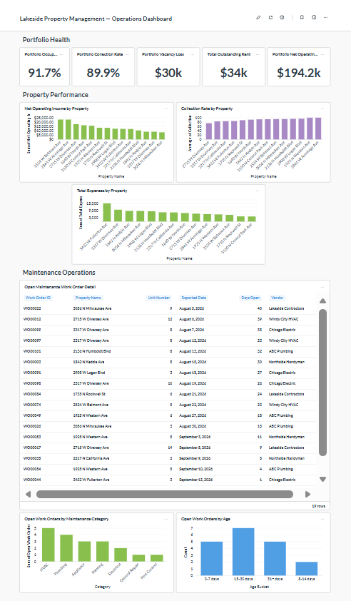

# Small Business Data Platform

An end-to-end data platform for a fictional property management company,
built to demonstrate how a small business can replace manual spreadsheet
reporting with an automated, reliable analytics workflow.

**Tech Stack:** Python • PostgreSQL • dbt Core • Metabase • Docker • PowerShell

**Highlights:** Automated ingestion • Layered data modeling • Data quality tests •
dbt unit testing • Data lineage • Business KPI modeling • One-command pipeline

> **Note:** All business data in this project is synthetic and was generated
> specifically for demonstration purposes.

## Business Problem

Lakeside Property Management manages approximately 180 rental units across
14 properties.

Operational data is spread across several systems:

- Property management software for tenants, rent, and occupancy
- Accounting software for expenses
- Maintenance tracking spreadsheets
- Property manager spreadsheets

Each month, the operations manager manually exports data from these systems,
cleans inconsistent property names and unit numbers, removes duplicates,
combines the files in Excel, builds pivot tables, and produces management
reports.

The process takes roughly two working days each month and leaves management
with reports that are already outdated by the time they are reviewed.

This creates several business problems:

- Unpaid rent may not be identified quickly
- Maintenance costs can grow before management notices
- Vacancies reduce revenue without immediate visibility
- Property performance is difficult to compare
- Reporting depends heavily on one employee's manual spreadsheet process

## Solution

This project replaces that manual workflow with an automated data platform:

CSV / Source Exports
        ↓
Python Ingestion
        ↓
PostgreSQL Raw Layer
        ↓
dbt Staging & Data Quality
        ↓
Business Analytics Marts
        ↓
Metabase Dashboard

The pipeline standardizes inconsistent source data, removes duplicate records,
applies business rules, validates data quality, and produces analytics-ready
datasets for reporting.

## Architecture

The platform follows a layered architecture that separates source ingestion,
data cleaning, business logic, and reporting.

### 1. Source Data

The demo simulates data exported from multiple small-business systems:

- Property and rent-roll data
- Accounting expenses
- Maintenance work orders
- Property reference data

The source files intentionally contain realistic data-quality issues such as
inconsistent property names, inconsistent status values, unit-number formatting,
and duplicate maintenance records.

### 2. Python Ingestion

A Python ingestion script loads the source CSV files into PostgreSQL.

The ingestion process preserves the source data in a `raw` schema so that
cleaning and business rules are handled downstream rather than modifying the
original source records.

### 3. PostgreSQL Raw Layer

PostgreSQL acts as the central data store.

Raw source tables provide a stable landing layer between ingestion and
transformation:

`CSV exports → raw PostgreSQL tables`

### 4. dbt Transformation Layer

dbt transforms raw source data into standardized, analytics-ready models.

The staging layer handles tasks such as:

- Standardizing property names
- Normalizing occupancy and maintenance statuses
- Cleaning unit identifiers
- Converting source strings to appropriate data types
- Deduplicating maintenance work orders
- Mapping inconsistent source values to stable property IDs

Business marts then calculate reusable metrics including:

- Occupancy
- Vacancy loss
- Scheduled rent
- Rent collected
- Outstanding rent
- Collection rate
- Expenses
- Net operating income
- Maintenance backlog and aging

dbt tests validate structural and business assumptions before the data reaches
the reporting layer.

### 5. Metabase Analytics

Metabase connects directly to the analytics models produced by dbt.

The operations dashboard provides management visibility into:

- Portfolio occupancy and collection performance
- Outstanding rent
- Vacancy loss
- Net operating income
- Property-level financial performance
- Maintenance backlog
- Aging maintenance work orders

This creates a reporting workflow where source data can be refreshed,
transformed, validated, and presented without rebuilding a manual Excel report.

## Technology Stack

| Component | Technology | Purpose |
|---|---|---|
| Source Data | CSV | Simulates exports from operational business systems |
| Ingestion | Python, pandas, SQLAlchemy | Loads source data into the database |
| Database | PostgreSQL 16 | Stores raw and analytics data |
| Transformation | dbt Core | Cleans, standardizes, tests, and models data |
| Data Quality | dbt tests | Validates structural and business rules |
| Analytics | Metabase | Provides dashboards and operational reporting |
| Infrastructure | Docker Compose | Runs PostgreSQL and Metabase locally |
| Automation | PowerShell | Executes the end-to-end pipeline |
| Version Control | Git / GitHub | Tracks project code and configuration |

## Project Structure

```text
small-business-data-platform/
│
├── data/
│   └── raw/                    # Synthetic source data
│
├── scripts/
│   ├── generate_sample_data.py # Generates fictional business data
│   └── load_raw_data.py        # Loads source data into PostgreSQL
│
├── small_business/             # dbt project
│   ├── models/
│   │   ├── staging/            # Source cleaning and standardization
│   │   └── marts/              # Business-ready analytics models
│   ├── seeds/                  # Reference/mapping data
│   └── tests/                  # Business-rule data quality tests
│
├── .env.example                # Example environment configuration
├── .gitignore
├── docker-compose.yml          # PostgreSQL and Metabase infrastructure
├── run_pipeline.ps1            # End-to-end pipeline runner
└── README.md

## Getting Started

### Prerequisites

The following software is required:

- Python 3.12+
- Docker Desktop
- Git

### 1. Clone the Repository

```bash
git clone https://github.com/stevieeven/small-business-data-platform.git
cd small-business-data-platform
```

### 2. Install Python Dependencies

```bash
python -m pip install -r requirements.txt
```

### 3. Configure Environment Variables

Create a local `.env` file from the provided example:

```powershell
Copy-Item .env.example .env
```

Update the values in `.env` if necessary.

The `.env` file contains local database credentials and is intentionally
excluded from version control.

### 4. Run the Pipeline

From the project root:

```powershell
.\run_pipeline.ps1
```

The pipeline will:

1. Load environment configuration
2. Validate the Docker Compose configuration
3. Start PostgreSQL and Metabase
4. Load raw source data into PostgreSQL
5. Build dbt models and run data quality tests
6. Make the analytics models available to Metabase

A successful run ends with:

```text
========================================
 SUCCESS
========================================
 Raw data loaded
 dbt models built
 Data quality tests passed
 Analytics are ready in Metabase
```

### 5. Open Metabase

After the pipeline completes, open Metabase at:

`http://localhost:3000`

### 6. Generate dbt Documentation

From the dbt project directory:

```powershell
cd small_business
dbt docs generate
dbt docs serve
```

The generated dbt documentation provides model descriptions, column
definitions, tests, compiled SQL, and an interactive lineage graph.

## Data Quality & Testing

The pipeline includes automated tests to validate both source-data integrity
and transformation logic before analytics models are used for reporting.

### Data Quality Tests

dbt data tests validate structural and business assumptions against the
loaded dataset.

Current checks include:

- Property IDs cannot be null
- Property IDs must be unique in the property-performance mart
- Property IDs must maintain referential integrity with the property master
- Property names cannot be null
- Occupied units + vacant units must equal total units
- Rent collected + outstanding rent must reconcile to scheduled rent

For example, the following business-rule test returns any property where
unit counts do not reconcile:

```sql
SELECT
    property_id,
    property_name,
    total_units,
    occupied_units,
    vacant_units
FROM {{ ref('property_performance') }}
WHERE occupied_units + vacant_units <> total_units
```

A successful test returns zero invalid records.

### Unit Testing

The project also uses dbt unit tests to validate transformation logic with
controlled input data.

The `property_performance` unit test provides a fictional four-unit property:

- 4 total units
- 3 occupied units
- 1 vacant unit
- $6,000 potential rent
- $4,500 scheduled rent
- $4,500 collected
- $1,000 expenses

The model is expected to calculate:

```text
Occupancy Rate      75.0%
Collection Rate    100.0%
Outstanding Rent     $0
Net Operating Income $3,500
```

This verifies the transformation logic independently of the actual source
dataset.

### Current Test Suite

```text
6 data tests
1 unit test

PASS=7
WARN=0
ERROR=0
SKIP=0
TOTAL=7
```

The full test suite can be executed with:

```bash
dbt test
```

Tests are also executed as part of `dbt build` in the automated pipeline.

## Dashboard & Business Insights



The Metabase operations dashboard converts the transformed data into a
management view of portfolio health, property performance, rent collection,
and maintenance operations.

### Portfolio Snapshot

Using the synthetic demo dataset, the platform identifies:

| Metric | Result |
|---|---:|
| Total Units | 180 |
| Occupied Units | 165 |
| Vacant Units | 15 |
| Occupancy Rate | 91.7% |
| Potential Monthly Rent | $362,350 |
| Vacancy Loss | $29,650 |
| Scheduled Rent | $332,700 |
| Rent Collected | $299,200 |
| Outstanding Rent | $33,500 |
| Collection Rate | 89.9% |
| Total Expenses | $105,025 |
| Net Operating Income | $194,175 |

These metrics provide management with a portfolio-level view while the
underlying property and work-order models allow individual problems to be
investigated.

### Example Business Insights

#### Rent Collection Risk

`2715 W Diversey Ave` has approximately $8,150 in outstanding rent and a
74.6% collection rate.

Instead of discovering the issue during a monthly spreadsheet reporting
cycle, management can identify the property directly from the dashboard
after each data refresh.

#### Vacancy Impact

`2908 W Logan Blvd` has approximately $5,500 in monthly vacancy loss.

Separating potential rent from scheduled rent makes the financial impact of
vacant units visible rather than combining vacancy and unpaid rent into a
single revenue shortfall.

#### Expense Anomaly

`3432 W Fullerton Ave` has approximately $15,025 in accounting expenses.

The synthetic source data also includes a sequence of plumbing, water-damage,
and repair transactions totaling $9,200 over roughly six weeks, demonstrating
how unusual property expenses can be surfaced for investigation.

#### Maintenance Backlog

The maintenance data contains 19 open work orders.

Of those:

- 12 have been open for at least 15 days
- 5 have been open for 31+ days

This allows the operations team to move from aggregate maintenance reporting
to an actionable queue of aging work orders.

### From Reporting to Decision Support

The purpose of the platform is not simply to automate data movement.

It creates a workflow where management can move from:

```text
Portfolio KPI
     ↓
Identify an exception
     ↓
Investigate the property
     ↓
Inspect the underlying operational records
     ↓
Take action
```

For example:

```text
89.9% portfolio collection rate
              ↓
Identify low-performing properties
              ↓
2715 W Diversey Ave — 74.6%
              ↓
$8,150 outstanding rent
              ↓
Investigate individual tenant balances
```

This turns a manual monthly reporting process into a repeatable operational
decision-support system.

